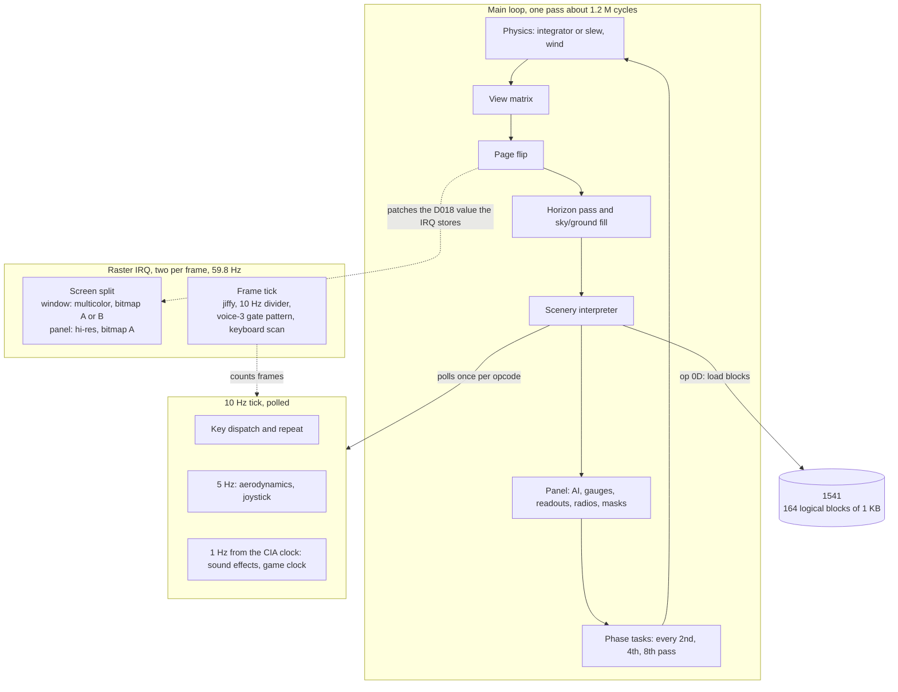
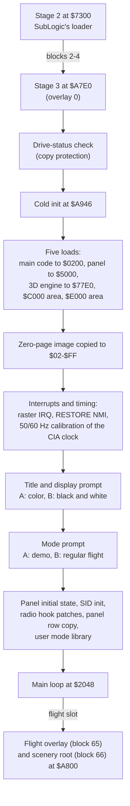
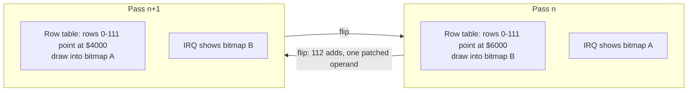
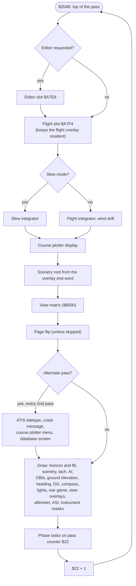
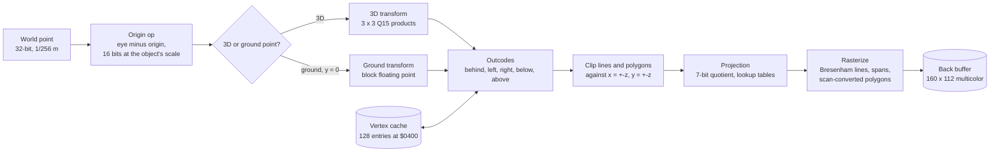
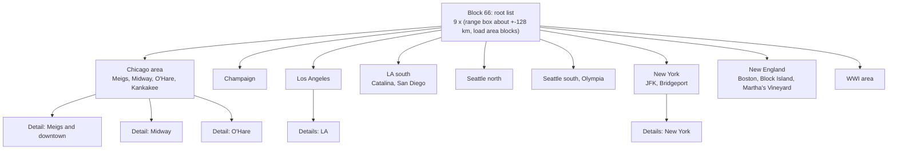
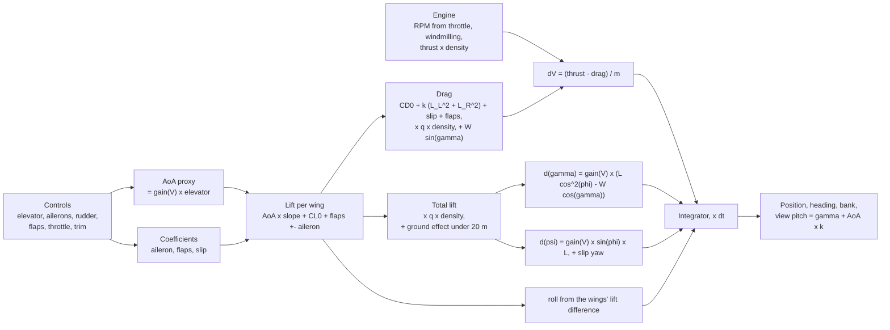
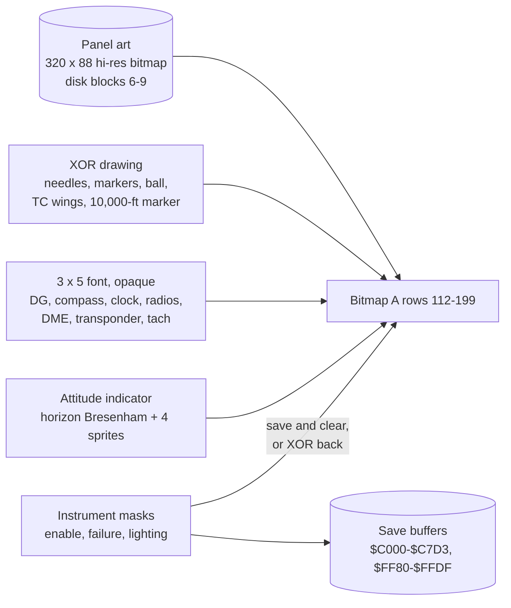

# Flight Simulator II on the Commodore 64: how it works

*An architectural tour of SubLogic's Flight Simulator II, version 1.0 (NTSC, 1984), written for
people who programmed the C64 themselves: if you know BASIC, 6510 assembly, the VIC-II, the SID,
raster interrupts and sprites, this is for you.*

## Foreword

I have always viewed Flight Simulator II as a pinnacle of Commodore 64 development.

Most of the C64's best-loved software leans on the hardware: sprites, smooth scrolling, character
graphics, the SID. FS2 goes the other way. It gives the VIC-II a bitmap and does everything else in
software on a 1 MHz 6510:

- a 3D renderer with clipping, perspective projection, filled polygons and a horizon;
- a flight model with lift, drag, stalls, an engine and wind;
- a full instrument panel with working radio navigation: VOR, ILS, ADF, DME, marker beacons and
  ATIS;
- a scenery database that is really a program, streamed from a 1541 while you fly;
- and, for good measure, a World War I dogfight game.

All of it fits in 64 KB with BASIC and the KERNAL switched off. It draws under one frame per
second, and it still works as a flight simulator. This document explains, from the inside, how
SubLogic pulled it off.

## About this document

- **Addresses** are C64 addresses of the v1.0 NTSC program as it sits in memory. Names come from
  [`re/symbols.json`](re/symbols.json).
- **How it was learned.** Everything here was established by running the original program in a
  cycle-counted lab (a 6502 core, a C64 bus and a virtual 1541), then proven against this
  repository's Swift port with differential tests. See
  [How this was learned](#how-this-was-learned).
- **No listings.** By design this repository contains no listings of SubLogic's code and none of
  its data tables. Behavior is described in prose, formulas and diagrams. The exact,
  routine-by-routine specifications are in [`re/docs/`](re/docs/).
- **Diagrams** are [Mermaid](https://mermaid.js.org/) (GitHub renders them) and plain text.

## Contents

1. [The program at a glance](#the-program-at-a-glance)
2. [The machine as FS2 sets it up](#the-machine-as-fs2-sets-it-up)
3. [The disk, the boot and the overlays](#the-disk-the-boot-and-the-overlays)
4. [The screen: a raster split and a double buffer](#the-screen-a-raster-split-and-a-double-buffer)
5. [Time: the main loop, the IRQ and the polled tick](#time-the-main-loop-the-irq-and-the-polled-tick)
6. [Fixed-point math](#fixed-point-math)
7. [The 3D pipeline](#the-3d-pipeline)
8. [The scenery: a bytecode database](#the-scenery-a-bytecode-database)
9. [Flight dynamics](#flight-dynamics)
10. [The instrument panel](#the-instrument-panel)
11. [Radio navigation and ATIS](#radio-navigation-and-atis)
12. [Input](#input)
13. [Sound](#sound)
14. [Modes, the editor and the other programs on the disk](#modes-the-editor-and-the-other-programs-on-the-disk)
15. [A C64 programmer's catalog of tricks](#a-c64-programmers-catalog-of-tricks)
16. [Quirks and bugs](#quirks-and-bugs)
17. [How this was learned](#how-this-was-learned)
18. [Further reading](#further-reading)

---

## The program at a glance

FS2 is one big main loop with no vsync wait. A pass computes the physics, builds a view matrix,
repaints the 160 × 112 window into a back buffer, interprets the scenery to draw the world on top,
updates the panel, and flips buffers. At Meigs Field, the default start, a pass takes about
1.2 million cycles: roughly 70 video frames, or about 0.85 frames per second. Around that loop, a
raster interrupt keeps the screen split and counts time, and a 10 Hz "tick" handles keys and the
aerodynamics at a steady rate however slow the drawing is.

| Problem | FS2's answer |
|---|---|
| A 3D world in 64 KB | The scenery is compact bytecode, streamed in 1 KB blocks by area and level of detail |
| No floating point, no multiply instruction | Q15 fixed point: shift-add multiplies, a non-restoring divide, a 66-entry cosine table with interpolation |
| No 3D hardware at all | A software pipeline: view matrix, outcode clipping, projection by division plus lookup tables, Bresenham lines and scan-converted polygons |
| A frame takes over a second to draw | Double buffering by rebasing a table of row addresses; a raster IRQ shows the finished bitmap |
| The world wants color, the cockpit wants detail | A raster split: a multicolor window above, a hi-res panel below |
| The physics must not depend on frame rate | The integrator scales by elapsed jiffies; the aerodynamics runs at a fixed 5 Hz from a polled tick |
| Too much program for the memory | Overlays in a 6 KB window, an editor cache in the RAM under the I/O area, no KERNAL or BASIC at run time |



---

## The machine as FS2 sets it up

### Banking

At run time the processor port `$01` holds `$35`: RAM everywhere except the I/O area at `$D000`.
BASIC and the KERNAL are gone, and FS2 owns the hardware vectors at `$FFFA-$FFFF` in RAM (the NMI
at `$2700`, the IRQ at `$2285`). The value the program normally wants in `$01` is kept in zero page
`$4B`, and every interrupt handler restores `$01` from it on exit. Two places bank the I/O out too
(`$01` = `$30`, all RAM): the editor-cache copy and the course plotter.

### Memory map

```text
$0000 +-------------------------------------------+
      | zero page: the hot variables              |  position, attitude, matrix, scratch
$0100 | stack                                     |
$0200 | row-address tables, 200 rows              |  <- the double buffer lives here
$0400 | vertex cache, 128 x 8 bytes               |  doubles as the editor's text screen
$0800 | core state, aircraft constants, palettes, |
      | horizon lists, mode record, flight state, |
      | polygon buffers ($0B10-$0E0F)             |
$0F00 | needle shapes, raster tables, cosine      |
      | table, 3x5 font                           |
$16AA | fixed-point math library                  |
$1A0B | needles, indicators, text renderer        |
$2000 | 24-vector ABI, main loop, raster IRQ,     |
      | 10 Hz tick, keyboard, key handlers,       |
      | aerodynamics, integrator, readouts, nav   |
$4000 +==== VIC bank 1 ===========================+
      | bitmap A: window rows 0-111               |
$5180 | panel bitmap: rows 112-199 (art)          |  always bitmap A
$6000 | bitmap B: window rows 0-111               |
$7180 | copy of panel character row 14            |
$7300 | SubLogic's disk loader                    |
$7A00 | attitude-indicator sprites                |
$7C00 | screen RAM (cell colors)                  |
$8000 +===========================================+
      | 16-vector renderer ABI, scenery           |
      | interpreter, clipper, polygon filler,     |
      | rasterizer, projection, transforms,       |
      | attitude indicator, turn coordinator      |
$A7E0 +---- overlay window -----------------------+
      | cold start / editor / war / flight /      |
      | database info, plus the scenery root and  |
      | the streamed scenery blocks               |
$C000 | instrument save buffers, user mode        |
      | library ($C800), SID driver ($CC00),      |
      | gauge drivers                             |
$D000 | I/O; underneath: the editor cache         |
$E000 | engine sound, overlay manager, wind, ADF, |
      | failures, time of day, engine model,      |
      | ATIS, instrument masks, course plotter    |
$FFFA | NMI / RESET / IRQ vectors (RAM)           |
      +-------------------------------------------+
```

A few things stand out:

- **The whole VIC bank is spoken for.** Bank 1 (`$4000-$7FFF`) holds two bitmaps, one screen RAM,
  four sprites and, squeezed into the gaps, the disk loader. The character ROM is not visible in
  bank 1, and FS2 doesn't need it: it draws its text with its own 3 × 5 font.
- **Bitmap B is only 112 rows.** The panel is single-buffered and lives only in bitmap A.
  Bitmap B holds a second copy of the window plus one copy of the panel's first character row
  (more on that below).
- **Memory is reused by phase.** `$0400-$07FF` is a vertex cache in flight and the text screen in
  the editor. `$D000-$E4FF`, the RAM under the I/O chips, holds a cached copy of the editor overlay
  or the course plotter's recorded track.
- **`$C000` is a ghost.** On disk, `$C000-$C7CF` holds SubLogic's remote debug monitor: code that
  installs its own IRQ/BRK handler and talks through expansion-port I/O at `$DExx`. The game never
  calls it, and at run time the area becomes the save buffer for blanked instruments.

### Two vector tables: an ABI between modules

`$2000-$2047` holds 24 jump vectors into the core and `$8000-$802F` 16 vectors into the renderer.
The overlays, the scenery root block and the display lists call through these tables, never into
the code directly, so the modules could be assembled and loaded separately. The disk even carries
a leftover linker export table at `$7B00` that names the entry points of the instrument and math
library. Two of the renderer vectors are hooks that the cold start patches to point at the ATIS
composer and the NDB handler.

### VIC-II setup

| Register | Value | Meaning |
|---|---|---|
| CIA2 `$DD00` | `$96` | VIC bank 1, `$4000-$7FFF` |
| `$D011` | `$3B` | Bitmap mode, display on, 25 rows, YSCROLL 3 |
| `$D018` | `$F0` / `$F8` | Screen RAM at `$7C00`; bitmap at `$4000` (A) or `$6000` (B) |
| `$D016` | `$D8` / `$C8` | Multicolor in the window, hi-res in the panel |
| `$D015`, `$D01C` | `$0F` | Sprites 0-3 on, all multicolor: the attitude-indicator bezel |
| `$D021` | dark gray or black | Pen 00 in the window; chosen by the color/B&W prompt |
| Color RAM | all white | Pen 11 in the window |
| `$D01A` | 1 | Raster interrupts only |

---

## The disk, the boot and the overlays

### SubLogic's logical block format

FS2 does not use DOS files. It reads the disk as **164 logical blocks of 1 KB**, each four
consecutive sectors in track order over tracks 1-35, with two exceptions: track 3 is skipped
entirely, and track 18 contributes only sectors 6-18 (the BAM and the directory keep sectors 0-5).
That is 656 sectors. SubLogic's own loader at `$7300` reads them with the drive's block-read
command and its own serial transfer, and the game asks for blocks by number.

| Blocks | Contents |
|---|---|
| 0-1 | The stage-2 loader, loaded at `$7300` |
| 2-4 | Stage 3, overlay 0: the cold start, title records, zero-page image |
| 6-9 | The panel bitmap, loaded at `$5000` |
| 10-25 | Main code and data, `$0200-$41FF` |
| 26-37 | The 3D engine and scenery interpreter, `$77E0-$A7DF` |
| 38-41 | `$C000-$CFFF`: the save buffers, mode library area, SID driver, gauges |
| 42-47 | Overlay 1: the mode editor |
| 48-63, 68-129 | Scenery: areas and detail blocks |
| 64 | Overlay 4: the database info screen |
| 65 | Overlay 3: plain flight (a header only) |
| 66 | The scenery root list |
| 150-157 | `$E000-$FFFF` |
| 158-160 | Overlay 2: Europe 1917 |

A block costs about 1.55 million cycles to load, roughly 1.5 seconds. During a load interrupts are
masked, the sprites are turned off (their DMA would break the serial timing), and the border
counts up one color per block: that is the flashing border you see when the aircraft crosses into
a new scenery area.

### The boot chain



Two details are worth noting:

- **The initial state is data.** The zero-page image and large parts of `$0800-$0EFF` (aircraft
  constants, palettes, horizon lists, default wind) are never written by code before use: their
  loaded values are the game's starting state.
- **The 50/60 Hz calibration** counts loop passes during one tenth of a second on the CIA1 time of
  day clock. On a PAL machine it switches the TOD to 50 Hz. The physics constants are not adjusted,
  though, so on PAL the game runs about 17% slow.

### Overlays

There is a single overlay window at `$A7E0-$BFFF`. Every overlay starts the same way:

```text
$A7E0  end-address word (where this overlay ends)
$A7E2  slot 0  cold start
$A7E8  slot 1  editor
$A7EE  slot 2  war game
$A7F4  slot 3  flight
$A7FA  slot 4  database info
```

Each slot is 6 bytes. In its own slot an overlay jumps to its entry point. Every other slot calls
a trampoline through the `$2000` vectors, which loads the overlay that slot belongs to and returns
into **the new overlay's** copy of the same slot, which then jumps to the entry. So the main loop
simply calls `$A7F4` every pass: with the flight overlay (or the war game) resident that slot just
returns, and after the editor or the database screen the call quietly brings the flight overlay
back.

After any overlay load, the overlay manager loads **block 66, the scenery root list, at the
overlay's end address**. In flight that is `$A800`; with the war overlay it is `$B1EA`. The scenery
interpreter finds its root from the end word at `$A7E0`, so the world follows whatever overlay is
loaded.

The editor overlay is cached: on its first use it is copied into the RAM under I/O
(`$D000-$E4FF`), and later uses swap the two regions instead of reading the disk.

---

## The screen: a raster split and a double buffer

### Layout

```text
              320 hi-res pixels = 160 multicolor pixels
 raster  +--------------------------------------------------+
  $20 -> |   IRQ: window state (multicolor, bitmap A or B,  |  border = time of day color
         |   border color by time of day)                   |
   51    |  +--------------------------------------------+  |
         |  |                                            |  |
         |  |   3D window: 160 x 112 multicolor          |  |  bitmap rows 0-111
         |  |   pens: 00 background, 01 sky,             |  |  double-buffered
         |  |         10 ground, 11 white                |  |
         |  |                                            |  |
  $A3 -> |  +--------------------------------------------+  |  IRQ: panel state (hi-res,
  163    |  |   panel: 320 x 88 hi-res                   |  |  bitmap A, gray border)
         |  |   [AI]  gauges, radios, readouts           |  |  bitmap rows 112-199
         |  |    ^ four multicolor sprites: the bezel    |  |  single-buffered
  251    |  +--------------------------------------------+  |
         +--------------------------------------------------+
```

### The raster split

The IRQ at `$2285` alternates between two phases, toggled by a flag in zero page:

| Raster line | Phase | Writes | Next IRQ |
|---|---|---|---|
| `$20` (32) | Window | border = the time-of-day color, `$D018` = the bitmap to show, `$D016` multicolor; then the frame tick | `$A3` |
| `$A3` (163, bitmap row 112) | Panel | border gray, `$D018` = bitmap A, `$D016` hi-res | `$20` |

The window phase fires well above the display window, so its stores are always done in time.

The panel phase is tighter. Line `$A3` is a badline: with YSCROLL 3 it is the first line of
character row 14, so the VIC takes 40 of its 65 cycles, and the handler's first store lands on the
next line. Whenever the window is showing bitmap B, the first panel line (more, if the interrupt
is held up) would therefore come from bitmap B. SubLogic's answer is simple: at init, panel
character row 14 is copied into bitmap B at `$7180`, so the top of the panel looks right whichever
bitmap the VIC is fetching.

### Colors without color RAM tricks

The window uses one byte of screen RAM for every cell (filled from the time-of-day palette into all
14 character rows) and leaves color RAM white. So the four multicolor pens mean the same thing
everywhere:

| Pen | Source | Use |
|---|---|---|
| 00 | `$D021` | Background: runways, the night sky |
| 01 | High nibble of screen RAM | Sky, and water |
| 10 | Low nibble of screen RAM | Ground |
| 11 | Color RAM, white | Lines and text |

Changing the time of day therefore means rewriting one value across screen RAM and changing the
window's border color. Day, dusk and night (with thresholds that change with the season) select
different nibbles, and the black-and-white prompt selects another set. The display lists
themselves pick the sky and ground fill patterns by time of day and altitude: below a cloud layer
the sky is white, and at night the fills switch to the background pen, so the window goes dark and
runway lights appear as dotted lines. Scenery colors are 4-bit codes that a 16-entry table maps
onto the four pens.

The panel is a hi-res bitmap, so each 8 × 8 cell has its own two colors from screen RAM
`$7E30-$7FE7`: white on dark gray for most of it, yellow on black for the radio windows, light blue
on brown for the attitude indicator, and a few lamp cells (stall, markers, carb heat) that the code
recolors by rewriting their screen RAM bytes.

### Double buffering by rebasing the row table

Every drawing routine finds a bitmap row through two tables at `$0200` (high bytes) and `$02C8`
(low bytes): 200 entries in the standard bitmap layout, `base + (row >> 3) * 320 + (row & 7)`. The
page flip is three steps:

1. Add a value to the first 112 high bytes. It alternates between `$20` and `$E0`, so mod 256 the
   window rows move from `$40xx` to `$60xx` and back.
2. Toggle that value.
3. Store the `$D018` value for the bitmap that was just finished **into the immediate operand of
   the store inside the raster IRQ**, at `$22B0`. The next window-phase IRQ shows it.



Nothing ever clears the back buffer: the horizon fill repaints all 112 rows on every pass, and
that is the clear. The panel rows of the table never change, so the panel is always drawn into
bitmap A. That works because the panel is drawn with XOR and erased by redrawing, never repainted
(see [The instrument panel](#the-instrument-panel)).

---

## Time: the main loop, the IRQ and the polled tick

### The frame tick

The window-phase IRQ ends with a short frame tick (the alternate IRQ that text mode and disk I/O
use runs the same tick without the VIC writes):

- the jiffy counter `$34` + 1;
- the 10 Hz divider `$0E6B` + 1;
- one step of the voice-3 gate-pattern player (see [Sound](#sound));
- the keyboard phase: a 4-frame cycle of idle, idle, matrix scan, release check, which is 15 Hz on
  NTSC.

That is all. The IRQ never runs game logic.

### The main loop



The tasks are spread over the passes:

| Cadence | Tasks |
|---|---|
| Every pass | Physics integration, view matrix, horizon, scenery, AI, OBIs, heading, DG, compass, altimeter, airspeed target, instrument masks |
| Every 2nd pass | ATIS teletype, crash message, plotter menu; odd passes: NAV1/NAV2 needles, VSI, ADF; even passes: splash check, maneuver timer, slip ball, engine model |
| Every 4th pass | Phase 0: time of day, turn coordinator, left fuel, wind layer, DME. Phase 1: right fuel, 10,000-ft marker. Phase 2: oil temperature, air density and bank auto-leveling. Phase 3: oil pressure, reality-mode failures |
| Every 8th pass | Radio search renewal, the demo check, the war-exit check |

### The polled 10 Hz tick

This is one of FS2's best ideas. The IRQ only counts frames. The real periodic work runs in a
routine at `$2330` that is **polled**: the scenery interpreter calls it once per display-list
opcode, and the wait-for-key loop calls it too. Each poll checks the divider: if 6 or more frames
have passed it subtracts 6 and runs one tick, otherwise it returns in 16 cycles. A backlog is caught
up one tick per poll.

```text
video frames  |  |  |  |  |  |  |  |  |  |  |  |  |  |  |  |  |  |  |  |  |  |  |  |   (about 70 per pass)
raster IRQs   ^^ ^^ ^^ ^^ ^^ ^^ ^^ ^^ ^^ ^^ ^^ ^^ ^^ ^^ ^^ ^^ ^^ ^^ ^^ ^^ ^^ ^^ ^^ ^^   two per frame, counting only
polls         ::::::::::::::::::::::::::::::::::::::::::::::::::::::::::::::::::::::   once per scenery opcode
10 Hz tick    T                 T                 T                 T                   every 6 frames: keys, repeat
5 Hz aero     A                                   A                                     every 2nd tick: aerodynamics
main pass     [phys|matrix|flip|horizon fill.........|scenery..................|panel|phases]
```

Why it matters:

- **The IRQ stays tiny and constant-time.** It never touches the simulation or the drawing state,
  so the zero-page scratch they share never has to be protected from it.
- **Key handling and aerodynamics run at a steady rate** even though a pass takes over a second:
  polls happen all through the scenery drawing, which is most of the pass, and a tick that comes
  due elsewhere runs at the next poll.
- **They run at safe points,** between opcodes, with the stack and zero page in a known state.

What the tick does:

| Rate | Work |
|---|---|
| 10 Hz | Dispatch one queued key; engine sound pitch; key repeat; bomb-whistle sweep |
| 5 Hz (not paused) | **Aerodynamics**; airspeed and VSI needles; joystick; auto-centering |
| 1 Hz (CIA1 TOD seconds change) | Sound effect state machine; the game clock; trim creep in reality mode |

### Time sources

| Source | Rate | Used for |
|---|---|---|
| Raster IRQ | 59.826 Hz (17,095 cycles per frame at 1,022,727 Hz) | Screen split, the frame tick |
| Jiffy `$34` | 60 Hz | The integrator's time step |
| 10 Hz tick | 10 Hz, polled | Keys, aerodynamics (5 Hz) |
| CIA1 time of day | 1 Hz | Game clock, sound effects |
| Main-loop passes | about 0.85 Hz at Meigs | Fuel burn, auto-leveling, wind drift, gauge phases |

There are also honest busy-waits: the engine starter (0.57 s), the crash or splash message
(2.2 s), the ATIS teletype's per-character delay, and the 50/60 Hz calibration at boot.

---

## Fixed-point math

The library at `$16AA-$1A0A` is everything the program knows about arithmetic.

**Formats:**

- **Q15:** signed 16-bit words with 32768 = 1.0; sines, cosines, matrix entries, coefficients.
- **Binary angles:** 16-bit, `$10000` = 360°; heading, pitch, bank, flight-path angle.
- **8.8:** speeds in m/s.
- **32-bit positions:** 1/256 m units.

| Routine | What | Cost (cycles) |
|---|---|---|
| `$16C9` | Signed Q15 multiply: (m · n) >> 15 | 271-454 (17-24 when an operand is 0) |
| `$16AA` | The same on zero-page operands named by A, X, Y (builds the view matrix) | + 55 |
| `$1802` | Signed fractional divide n / d in Q15, valid for \|n\| < \|d\| | 692-771 |
| `$188A` | Unsigned 16 × 16 → 32 multiply | 635 + 16 per set bit |
| `$18B8-$18D0` | Sine and cosine of 8-, 9- and 16-bit angles | 33-514 |
| `$196D`, `$1961` | Signed 8 × 8 multiply (2xy or xy) | 119-152 |
| `$19E2` | Linear interpolation in a speed-indexed table | about 80 + an 8 × 8 multiply |

The routines are clever and a little sloppy, and the sloppiness is part of the game:

- **The Q15 multiply** inverts the first operand and adds on its zero bits. Its low six bits only
  add the second operand's high byte, which saves time and makes the routine non-commutative. The
  error stays within about ±2 LSB.
- **The divide** is 15 non-restoring steps, and the result always has bit 0 clear.
- **The 8 × 8 multiply** adds a bias bit that comes from the caller's carry flag, so `1 × 1` is 3
  or 2 depending on what ran before. Callers chain the carry from one multiply into the next.
- **Sine and cosine** come from 66 entries of cos(i · 1.40625°): 64 steps per quadrant, an exact
  entry, an average of two neighbors for a half step, or a linear interpolation by a Q15 multiply.
  One entry, for 35°, is about 300 units low: a typo in the data that every calculation near that
  angle quietly uses.

These errors feed the integrator pass after pass. A "correct" math library would fly a slightly
different airplane, which is why the port keeps every one of them.

---

## The 3D pipeline



### World and eye coordinates

Positions are signed 32-bit numbers in 1/256 m: X east (`$5A-$5D`), Y up (`$5E-$61`), Z north
(`$62-$65`). The high word is in units of about 256 m, and the whole range is about ±8,400 km,
enough for the continental United States with room to spare. Y = 0 is the scenery's ground plane.

### Origins: a floating origin with a scale per object

32-bit math on a 6510 is far too slow to do per vertex, so the display lists set an origin before
each object. Op `07` subtracts a 32-bit origin from the eye position and keeps **16 bits of the
difference chosen by a scale byte**: bits 0-15, 4-19, 8-23, 12-27 or 16-31, so units of 1/256 m
up to 256 m. Op `24` is a cheaper form with an origin in whole high-word units; at the meter scale
it is the area lists' usual origin. After that every vertex of the object is a 16-bit number in
units that suit it: fine for a building, coarse for a mountain range 100 km away. Everything
downstream is 16-bit.

### The view matrix

`$8111` builds the matrix every pass from pitch, bank and heading, the view direction (eight
directions at 45° steps, or straight down) and the radar view (straight down from above, using a
separate radar height). It takes twelve Q15 products, costs 5,600-7,600 cycles, and is pre-scaled:
the eye-x row is halved and the eye-z row quartered. That turns the frustum into the cheap test
|x| ≤ z, |y| ≤ z, which works out to a field of view of 53° × 28°. There is no near plane; the apex
is at the eye, and anything with z < 0 is simply behind.

The yaw that goes into the matrix uses only its high byte (the low byte is stale), so the world
turns in steps of 1.4°: 256 headings.

### Two point transforms

- **3D points** (`$A1CE`, 3,400-4,200 cycles): the difference to the eye, halved if it overflows
  16 bits, then three dot products of Q15 multiplies. A sum that overflows halves the whole result.
- **Ground points** (`$9FD0`, 1,300-2,000 cycles): for points on y = 0, a cheaper **block floating
  point** transform. The differences and the precomputed ground base are shifted left together
  until they nearly overflow, multiplied with 8 × 8 multiplies on their high bytes, and
  renormalized. Each point gets its own exponent, so precision varies from point to point: the
  slight shimmer of ground lines in FS2 comes from here.

Transformed points can go into the **vertex cache**: 128 entries of 8 bytes at `$0400`, holding the
eye-space coordinates and either the screen position or the outcode. Display lists reuse cached
corners for many lines and polygons, and op `04` culls a whole group of cached points at once when
they all lie beyond one common plane.

### Clipping

Each point gets a 5-bit outcode: behind (z < 0), left (x + z < 0), right (z − x < 0), below and
above. A line whose two outcodes share a bit is rejected outright. Otherwise each end is moved onto
the planes in turn along the line, with the parameter t computed by the fractional divide; if a
denominator overflows, both points are halved and the plane is tried again. Polygons go through a
Sutherland-Hodgman clipper, four passes over structure-of-arrays vertex buffers at `$0B10` (twelve
arrays of 64 bytes).

### Projection

After clipping, `$9F94` projects with one division per axis: an unrolled 8-step non-restoring
division produces a 7-bit quotient q = 128 · |n| / z, and two 128-entry tables turn it into a screen
offset, TX[q] = ⌊5q / 8⌋ horizontally and TY[q] = ⌊7q / 16⌋ vertically, around the window's center
(80, 55). A point costs 190-820 cycles. Perspective in FS2 is literally a 7-bit number.

### Rasterizing

Coordinates are multicolor pixels, x 0-159 and window rows 0-111. The 2D routines never clip;
everything arrives already clipped.

- **Pens are self-modifying code.** Every pixel write reads the byte, applies two operations with
  mask tables indexed by the pixel's position in the byte, and stores it back. The pen routine
  rewrites those two operations (OR, AND or XOR, and their table operands) at every plotting site
  in the plot, line and span code. Choosing a color is a handful of stores; the inner loops have no
  color logic at all. The dotted pen used for lights at night patches the second operation into a
  call of a plotter that only writes every fourth pixel.
- **Lines** are Bresenham, swapped so they always start at the right end and step left, with four
  loops for x-major/y-major and up/down. They walk the bitmap's character-cell layout directly:
  ±1 inside a cell, ±(320 − 7) across a character row, −8 when x crosses into the previous byte.
  About 49 cycles a pixel horizontally and 57 vertically.
- **Spans** fill leftward from an x. Short ones go pixel by pixel, then whole bytes. Long ones use
  an **unrolled row filler** at `$851B`: 40 stores, one per column of the row. The caller writes a
  return opcode over the store just past the last column it wants, enters at the first column it
  wants, and restores the byte afterward. A full 160-pixel row costs 465 cycles.
- **Polygons** are scan-converted from an edge table (start row, rows, x and an 8.8 slope per
  edge). Per scanline the crossings are collected, bubble-sorted and filled in pairs with spans.
- **Text** uses a 3 × 5 font of 59 glyphs, ASCII space through Z, in opaque 4-pixel cells. The same
  routine prints the white menus in the window and every digit on the panel, where one font pixel is
  two hi-res pixels.

### The horizon, and the clear that isn't one

The drawing begins with the horizon pass (`$83A4`). It takes one of four tiny ground display lists,
a very long line far ahead in the current heading quadrant, and runs it through the normal ground
transform and line clipper, **with the line drawer's call patched into a harmless read**. Nothing
is drawn; the clipped screen endpoints are just captured. That is the horizon.

Then the fill paints every row of the window: whole rows above the horizon with the sky pattern,
whole rows below with the ground pattern, and the rows the horizon crosses by a Bresenham walk that
splits each row at the boundary. The split uses the row filler twice, once with a return planted
at the boundary column and once entered just after it, and builds the mixed boundary byte by
shifting both patterns. That costs 41,000 to 61,000 cycles, and it doubles as the screen clear. The
horizon line itself is left as a 7-byte display list that the area lists draw later.

### The attitude indicator reuses the horizon code

The attitude indicator is drawn into hi-res panel cells colored light blue on brown. Its chord
comes from sin and cos of the bank, offset by pitch, and is drawn by **the same horizon
Bresenham**: the first instruction of the split-row routine is temporarily patched into a jump to
an AI span routine, and put back afterward. The four multicolor sprites lay the bezel, the tick
marks and the aircraft symbol over it. It only redraws when pitch or bank changed by two units or
more, which saves its 4,800 to 10,400 cycles whenever the attitude holds steady.

### What things cost

| Work | Cycles |
|---|---|
| View matrix | 5,600-7,600 |
| Horizon pass and sky/ground fill | 41,000-61,000 |
| One 3D point, transformed / projected | 3,400-4,200 / 190-820 |
| One ground point, transformed | 1,300-2,000 |
| One scenery opcode, dispatch and poll | about 59 |
| A line | about 140-185 setup, then 49-57 per pixel |
| Attitude indicator, when it redraws | 4,800-10,400 |
| Clearing the window for a menu | 71,891 |
| One main-loop pass at Meigs | about 1.2 million |

---

## The scenery: a bytecode database

FS2 has no models. Its scenery is **display lists: bytecode that the interpreter at `$8730` runs
every pass**. A list doesn't just describe geometry. It tests where you are and jumps over what you
can't see, sets origins and colors, emits points, lines and polygons, writes game variables,
registers radio stations, and loads more of itself from disk.

### The instruction set

The opcode table at `$86A4` has 70 entries; 40 are used, and any byte of `$46` or more ends the
list. Relative jumps are relative to the opcode's own address.

| Group | Ops | What they do |
|---|---|---|
| Flow | `0B` jump, `18` call, `19` return, `09` call through a pointer, `0A` call native code, END | Lists call lists; nesting is unbounded |
| Tests | `13` range box, `14` range box and altitude, `20`-`22` range tests on 1-3 variables, `23` bit test, `28` compare, `04` cull cached points | A failed test jumps past the guarded scenery |
| Origins | `07` 32-bit origin with a scale, `24` whole-unit origin | Sets up the 16-bit object space |
| 3D geometry | `00` dot, `01` moveto, `02` lineto | Points through the 3D transform |
| Ground geometry | `40` moveto, `41` lineto, `2B` dashed line | Points on y = 0 through the ground transform |
| Vertex cache | `31` and `42` store a point, `32` moveto, `33` lineto, `35` dot | Shared corners |
| Polygons | `2F` begin, `29` end and fill (outside a polygon: close the path) | Filled shapes |
| Other drawing | `06` screen line, `03` runway | |
| Pens | `12` color code, `1B` white, `1C` dotted at dusk and night | |
| Data | `1A` copy a word, `25` store a word | Writes any game variable |
| Radio | `1D` VOR/localizer, `05` NDB, `1E` ATIS | Station records |
| Streaming | `0D` load blocks | Pulls more scenery from disk |

A range box (`13`) compares the eye's high words with a center and a radius on the east and north
axes; if you're outside, it unwinds the interpreter's return addresses and jumps. Range boxes
nest: a large box around an area, smaller boxes around each airport, smaller ones around details.
That one mechanism provides culling, level of detail and the boundaries of the database.

### How the world is laid out



- The **root list** is block 66, loaded at the overlay's end address. It holds nine pairs of a range
  box around an area's center and a load op that brings the area's blocks in right behind the root.
  The boxes don't overlap, so at most one area matches; execution then falls straight through into
  the freshly loaded area code. Outside every box, the last area stays in memory and its own tests
  hide everything.
- **Areas** are 4-6 blocks of display lists. Their headers write game variables: heading offsets
  added to every runway heading, the ATIS time-zone offset, and each airport's elevation behind its
  own range box, which the ground-elevation tracker follows.
- **Detail blocks** stream into a second slot at an area-specific address, behind small boxes a few
  kilometers to a dozen kilometers across, usually with an altitude test as well ("near and
  low").
- The **block cache** keeps a tag per slot. Asking for the block a slot already holds costs nothing;
  loading a slot clears the tags of the slots above it, since their blocks sat on top.
- **A guard at `$C000`.** While loading scenery, the loader stores nothing at `$C000` or above.
  Several areas are longer than the window; their tails are simply cut off, and the `$C000` area
  keeps its instrument save buffers.

### Scenery that does more than draw

- **Radio stations are found by drawing.** Tuning a radio raises a search request. During the next
  pass, the first matching station record the interpreter meets *inside its range boxes* answers it
  with its position. Every eighth pass the search is renewed, so a station is lost about eight
  passes after you leave its range box. A station's reception range is literally its scenery box.
- **Runways are generated.** Op `03` takes a heading, length and width, computes the four corners
  with sin and cos, writes them into a small template display list (a filled rectangle and a dashed
  centerline) and runs it as a nested pass.
- **Palettes come from the scenery.** The area lists copy palette words by time of day and altitude
  into the active colors with op `1A`: day, dusk and night patterns, and a white sky under the
  clouds.
- **Other programs reuse the interpreter.** The war game draws each enemy by running a tiny list
  whose point it rewrites per enemy. The course plotter records your track as display-list ops into
  the RAM under I/O and draws it back into the world through the same interpreter.

---

## Flight dynamics

### Units

| Quantity | Storage | Unit |
|---|---|---|
| Position | 32-bit east, up, north | 1/256 m; the high word about 256 m |
| Altitude | Meters above the local ground datum | Ground contact at 3 m |
| Airspeed V | 16-bit unsigned | 8.8 m/s; one scalar, no separate ground speed |
| Vertical speed | 16-bit | 8.8 m/s = V · sin γ |
| Flight-path angle γ, bank φ, heading ψ | 16-bit binary angles | `$10000` = 360° |
| Air density | Q15 | ≈ 1 − 2.5 m / 32768 per meter of altitude |
| Engine | RPM / 50 | |
| Time step dt | Q15 seconds | jiffies × 546 / 32768: 60 jiffies ≈ 1.0 |

### Two rates

- **The aerodynamics** (`$2F45`) runs at 5 Hz from the polled tick. It computes rates: the change
  in speed, the rate of the flight-path angle, the turn rate and the lift on each wing.
- **The integrator** (`$32EE`) runs every pass and multiplies those rates by the real elapsed time,
  computed from the jiffy counter. A slow pass simply takes a bigger step. The step saturates at
  about one second, so a long stall in drawing doesn't throw the aircraft across the map.

A few effects run once per pass instead of per unit of time (fuel burn, bank auto-leveling, wind
drift, the gauge phases). On the C64 a pass took a predictable time, so it didn't matter. It matters
for a port: run the logic at 60 Hz and fuel burns about ten times too fast.

### The model

This is not a six-degree-of-freedom simulation. It is a point mass flying along a flight path, with
a handful of coefficients and speed-indexed gain tables, tuned to feel right:



- **The elevator sets the angle of attack directly**, scaled by a gain that depends on airspeed. The
  5 Hz step changes the flight path, and the nose drawn on the screen is the flight path plus a
  fraction of the angle of attack.
- **Each wing has its own lift.** Ailerons add lift to one wing and remove it from the other, and the
  roll rate comes from the difference times the distance flown. Rudder and ailerons together set a
  slip that adds drag, yaw and roll.
- **Stalls.** Past one angle-of-attack threshold the stall lamps light and the horn sounds; past a
  higher one a stall timer zeroes the lift for 15 aerodynamics steps (3 seconds). Then the nose
  drops and the cycle can repeat.
- **Loops work.** When the flight-path angle passes 90°, it is reflected (180° minus γ), and bank
  and heading flip by 180°.
- **The ground.** Below 3 m you're on the ground. Touch down sinking 9 m/s or more, or banked more
  than about 14°, and it's a crash: a crash sound, the message, a 2.2-second pause, then the mode
  reloads.
- **Water is detected by looking at the screen.** On the ground in the front view, `$F996` reads one
  byte of bitmap A near the bottom right of the window. If it holds the water pattern (pen 01, the
  same pen as the sky) on three checks in a row, you've splashed. The physics reads the frame
  buffer.
- **Density** falls linearly with altitude and scales lift, drag and thrust.
- **The engine** model has a throttle-to-RPM table, a windmilling table by airspeed, magnetos,
  mixture, carburetor heat, left and right tanks (24-bit amounts), oil temperature and pressure that
  ramp toward targets, and, in reality mode, a starter that busy-waits half a second.
- **Wind** comes in up to four layers, chosen by altitude against the shear altitudes set in the
  editor; its drift is subtracted from the position every pass.
- **Reality mode** adds failures: about every 40 passes, a pseudo-random number made from the
  position's bytes is compared with the reliability setting, and on a hit the window shows an
  aircraft-problem message and an instrument or engine failure strikes. The altimeter and the DG
  drift, and the trim creeps.
- **Slew mode** replaces the integrator with a repositioning mode whose rates grow exponentially
  with the key presses.

The aircraft constants (lift slope, drag coefficients, weight, the gain tables) are data on the disk,
never written by code.

---

## The instrument panel



- **The artwork is a bitmap** loaded from disk, with stale digits that the init code redraws.
- **Everything that moves is drawn with XOR** and erased by drawing it again in its old position.
  There is no save-under and no repaint, so the panel bitmap is persistent state and needs only one
  buffer. Where two needles overlap they cancel; you can see it where the altimeter's hands cross.
- **Needles** have 88 positions per revolution. One quadrant is stored as 23 run-length shapes per
  needle length (an x offset and a run per scanline), and the other three quadrants come from
  patching four opcodes in the drawing loop: add or subtract the offset, step x right or left, step
  the row up or down.
- **Linear indicators** (elevator, ailerons, rudder, throttle, flaps, trim, mixture, fuel and oil
  bars, the slip ball) are small XOR point lists.
- **The turn coordinator** XORs two lines from a 16-entry table of wing positions.
- **Instrument masks.** Three bytes of bits combine what the editor enabled, what has failed and the
  night lighting. When a bit changes, `$F3F0` either saves an instrument's pixels and clears its
  area, or puts them back with XOR. The save buffers live in the dead debug monitor's memory at
  `$C000` and at the top of memory.
- **Updates are staggered** over the pass phases (see the cadence table above): a fuel gauge on one
  pass, an oil gauge on another.

---

## Radio navigation and ATIS

| Radio | Tuned by | Found through |
|---|---|---|
| NAV1, NAV2 | Keys edit ASCII digits in a text record, converted to BCD | Op `1D` VOR and localizer records |
| COM | Same | Op `1E` ATIS records |
| ADF | Same | Op `05` NDB records |
| Transponder | Octal digits | Display only |

- **Bearings** come from a vector-angle routine with its own 17-entry arctangent table and linear
  interpolation, plus a distance routine. From those the nav task builds the course deviation for the
  needle, the TO/FROM flag and the DME readout.
- **Localizers** are VOR records with fractional coordinates; that flag makes the NAV1 needle
  follow the runway course the scenery stored instead of the OBS setting. The glideslope needle and
  the outer, middle and inner markers (lamps plus tones at exactly 400, 1300 and 3000 Hz) complete
  the ILS.
- **The ADF** shares NAV2's station slot and draws its face over the NAV2 indicator when it is
  enabled.
- **ATIS.** When the COM frequency matches an ATIS record in range, the composer at `$F16A` fills a
  set of phrase strings with live values (temperature, wind, the Zulu hour from the area's time-zone
  offset, the ceiling, the runway in use), and the teletype at `$F239` types the broadcast into the
  window one character at a time, with a delay set by the editor's communication rate.

---

## Input

- **The keyboard matrix** is scanned by the frame IRQ every fourth frame (15 Hz), with a release
  check on the frame after. A key must be down during a scan frame to be seen at all.
- **Held keys** sit in four slots; new presses go into an 8-entry ring buffer.
- **One key per 10 Hz tick** is dispatched through a 96-entry handler table. Every control input is a
  discrete event: the elevator moves in steps.
- **Auto-repeat** applies only to the first two keys held: the first repeat comes 6 ticks after the
  press, then one per tick.
- **Joysticks** are sampled with the matrix and applied at 5 Hz, with optional auto-centering.
- **RUN/STOP + RESTORE** raises the NMI at `$2700`, which jumps to the cold-start slot: a full
  restart through the title and prompts.

---

## Sound

The whole sound system is a small register-level driver at `$CC00-$CE83` plus three pieces of game
code that call it.

| Voice | Use |
|---|---|
| 1 and 2 | Engine drone: two sawtooths through the low-pass filter, the second an octave up and detuned by one step, so they beat slowly. Pitch follows RPM (about RPM / 102 Hz). Volume does not follow the throttle. |
| 3 | Every effect, gated once per video frame by the IRQ's pattern player |

- **The pattern player** shifts an 8-bit on/off rhythm out one bit per step, a step lasting a set
  number of frames, and writes the gate bit to voice 3. That is how the marker beacons get their
  dashes and dots, and how the machine gun stutters.
- **The effect state machine** runs once a second from the CIA time-of-day clock: stall horn,
  crash, touchdown, the three markers, machine gun, bomb release, the bomb's falling whistle (a
  frequency sweep at 10 Hz) and the explosion.
- **The marker tones land exactly on 400, 1300 and 3000 Hz** with the NTSC clock of 1,022,727 Hz.
- **What FS2 never does:** read oscillator 3 (the SID is not a random number source here), use pulse
  waves, sync or ring modulation, or make sounds for wind, gear, flaps or key clicks.

---

## Modes, the editor and the other programs on the disk

- **Startup.** The title asks for a color or a black-and-white display, then for a mode: A for demo,
  B for regular flight.
- **Demo mode** loads built-in mode 2, a takeoff from Meigs with the controls preset so that the
  aircraft flies itself. It climbs away in a slow turn and eventually crashes, about 28 minutes in,
  and the demo starts again.
- **The mode editor** (overlay 1) switches to the text screen: bank 0, the ROM character set, screen
  RAM at `$0400` (the vertex cache's memory). Its two pages of fields edit a 65-byte mode record:
  position, altitude, heading, controls, time, season, clouds, wind layers and shears, reliability,
  communication rate, sound, and switches such as REALITY MODE, EUROPE 1917 and ADF ENABLE. There are
  10 built-in modes and 15 user modes at `$C800`, and the user modes can be saved to a separate
  FS2-formatted disk.
- **Europe 1917** (overlay 2) is a complete little game. Six enemy aircraft belong to two bases; each
  is dormant until you cross its trigger lines, then pursues you inside its attack zone and fires
  when it is close and on your scope. You have guns with tracers and bombs. A radar scope and a
  status panel replace the radio stack, and a status line rotates through ammunition, score, bombs
  and hits. Damage caps the engine's RPM and leaks fuel. Turning it on forces mode 7 and the WWI
  area; turning it off restarts the whole program.
- **The course plotter** records your track into the RAM under I/O as display-list ops and draws it
  back into the world as a line, to be seen from the cockpit or the radar view.
- **The database info screen** (overlay 4) lists the scenery databases on the disk.
- **The radar view** is the 3D renderer looking straight down from above.

---

## A C64 programmer's catalog of tricks

1. **A double buffer for 112 adds.** Flipping means rebasing the window rows of the row-address table,
   not copying or clearing memory.
2. **The shown bitmap is an immediate operand.** The main loop patches the value the raster IRQ
   stores to `$D018`; the IRQ needs no variable lookup and no branch.
3. **Self-modifying pens.** Color selection rewrites the read-modify-write operations at every
   plotting site; the inner loops have no color logic.
4. **Planted returns.** One unrolled 40-column filler serves any span: write a return opcode where
   you want it to stop, enter where you want it to start.
5. **Code reuse by patching.** The horizon's Bresenham draws the attitude indicator once the
   split-row routine's first instruction is turned into a jump.
6. **Compute without drawing.** The horizon is found by running a display list through the real
   transform and clipper with the line call patched out, then reading the clipped endpoints.
7. **Scenery as a program.** One interpreter handles geometry, culling, level of detail, radio
   lookups, game variables and disk streaming.
8. **A cooperative scheduler.** The IRQ only counts; the 10 Hz work runs where the interpreter polls,
   between opcodes.
9. **Time-scaled physics.** Rates are computed at a fixed 5 Hz and integrated with a measured time
   step, so the simulation keeps real time at any frame rate.
10. **Block floating point** for ground points, and a floating origin with a per-object scale for
    everything else: 16-bit math with 32-bit range.
11. **Perspective as a lookup.** One 7-bit division per axis and two 128-byte tables.
12. **XOR instruments.** A single-buffered, persistent panel with no repainting.
13. **The physics reads the frame buffer** to find water.
14. **Self-describing overlays.** Each overlay carries the same five entry slots, so a call to any
    slot loads the right code; the scenery root follows the overlay's end address.
15. **RAM under I/O** as a cache for a whole overlay.
16. **An ABI of vector tables** between separately assembled modules.
17. **A copy of one panel row** in the second bitmap, so a split that lands a line late is invisible.
18. **Four sprites** for the one part of the panel the bitmap couldn't do well: the round bezel over a
    rotating horizon.

---

## Quirks and bugs

The port keeps all of these, because they are part of how the original behaves.

- **The heading** in the view matrix uses only its high byte: the world turns in 1.4° steps.
- **The cosine table** has one bad entry, and the 8 × 8 multiply takes its rounding bit from the
  caller's carry.
- **The integrator's time step** includes a stale byte left by whatever math ran last (up to about
  half a jiffy), saturates after about 60 jiffies and wraps after 120.
- **PAL machines** run the simulation about 17% slow.
- **The game clock runs two to three times too fast** while a course plot is displayed: an
  IRQ taken inside the tick leaves the I/O banked out, and the clock then reads the RAM under the
  CIA's time-of-day register.
- **In Europe 1917, R calls `$FD00`,** which is empty on the disk: the 6510 runs a chain of break
  interrupts through zero-filled memory until stray bytes near the top of memory happen to decode
  as a call back into the main loop's draw sequence. The port treats it as a no-op. Bombs also
  never score on this disk: nothing writes the bomb countdown.
- **Polygon buffers have no bounds checks.** Scenery polygons are small and never overflow, but
  huge ones write past the 64-entry arrays, and a polygon row with a single crossing makes the
  bubble sort scramble zero page, processor port included.
- **Sound effects lag.** The touchdown sound can come up to a second late, and the stall horn and
  marker tones run on for one to three seconds after their cause ends, because the effect machine
  runs at 1 Hz.

---

## How this was learned

This repository is a Swift port of FS2 that translates the original routine by routine, and it is
**memory-faithful**: the port keeps the original's 64 KB image at the original addresses and every
ported routine reads and writes the same bytes, zero-page scratch and self-modified operands
included, at the same cycle cost. That is what made this level of detail checkable:

- **The lab** (`Sources/M6502`, `Sources/FS2LabKit`, `fs2lab`) runs the original program on a
  cycle-counted 6502, a C64 bus with the VIC, CIAs and SID, and a virtual 1541 that runs SubLogic's
  own loader. Lab sessions confirmed or corrected every claim about behavior.
- **Routine diffs** run each ported routine next to the original on thousands of input states and
  require the same 64 KB image, registers and cycle count.
- **Whole-game replays** feed the port the exact interrupts, keys and I/O values recorded from the
  original and compare memory at the top of every main-loop pass.
- **Golden frames** require the port's picture to match the lab's pixel for pixel.

The port's subsystems mirror the sections above: `Sources/FS2Core/Math`, `Raster`, `Render3D`,
`Scenery`, `Sim`, `Panel`, `Radio`, `Input`, `Sound`, `Display`, `Modes` and `Game` (the main loop,
interrupts, cold start and overlays).

---

## Further reading

The per-subsystem specifications, with every routine, variable and test:

| Topic | Document |
|---|---|
| The memory map, the block filesystem, the boot chain and every region | [`re/docs/memory-map.md`](re/docs/memory-map.md) |
| The main loop, the interrupts, the 10 Hz tick and the cold start | [`re/docs/main-loop.md`](re/docs/main-loop.md) |
| VIC setup, the raster split, the double buffer, the palette | [`re/docs/display.md`](re/docs/display.md) |
| Pens, lines, spans, the row filler, the 3 × 5 text | [`re/docs/raster.md`](re/docs/raster.md) |
| The view matrix, the horizon, clipping, polygons, projection, the AI | [`re/docs/render3d.md`](re/docs/render3d.md) |
| The display-list interpreter, its opcodes, streaming and overlays | [`re/docs/scenery-3d.md`](re/docs/scenery-3d.md) |
| The fixed-point math library | [`re/docs/math.md`](re/docs/math.md) |
| The flight model, the engine, wind, failures, crash and splash | [`re/docs/flight-model.md`](re/docs/flight-model.md) |
| Needles, gauges, readouts, instrument masks | [`re/docs/panel.md`](re/docs/panel.md) |
| The radios, the nav instruments, the ADF | [`re/docs/radios.md`](re/docs/radios.md) |
| ATIS | [`re/docs/atis.md`](re/docs/atis.md) |
| The keyboard, joysticks and every key handler | [`re/docs/input.md`](re/docs/input.md) |
| The SID driver and effects | [`re/docs/sound.md`](re/docs/sound.md) |
| The editor and mode records | [`re/docs/editor.md`](re/docs/editor.md) |
| Europe 1917 | [`re/docs/war.md`](re/docs/war.md) |
| The course plotter and the database screen | [`re/docs/course-plotter.md`](re/docs/course-plotter.md) |
| What is not ported, and why | [`re/docs/excluded.md`](re/docs/excluded.md) |
| How a routine is translated and proven | [`re/docs/porting-guide.md`](re/docs/porting-guide.md) |

*This is an unofficial project, not affiliated with or endorsed by the rights holders; see the
[README](README.md#legal).*
